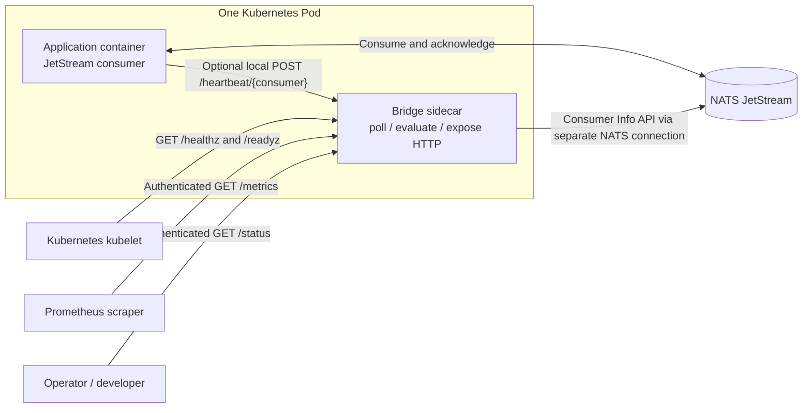
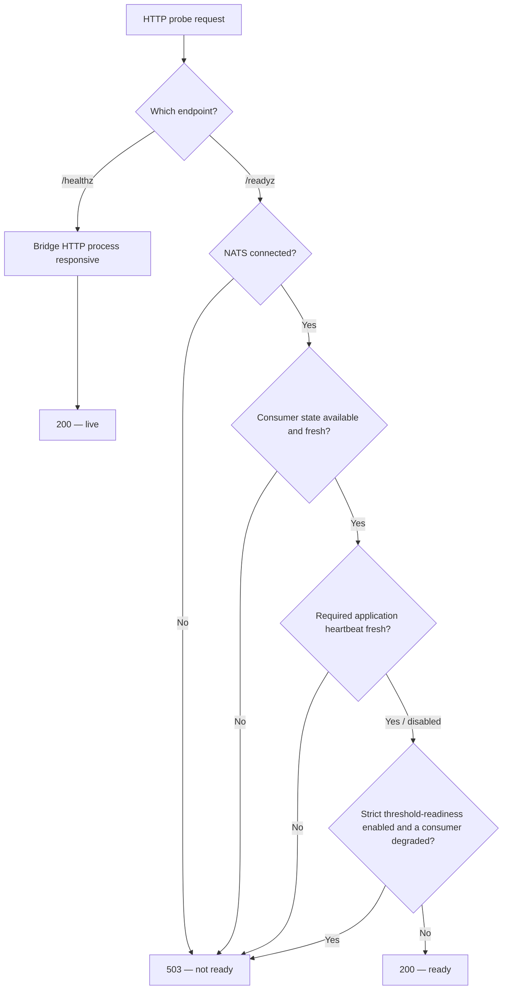

# Architecture — initial source preview

This page documents the current **sidecar implementation**, not a Kubernetes operator, deployment controller or supported binary/image release. For a runnable setup, see [Docker quickstart](docker-quickstart.md) and [Helm sidecar examples](helm-sidecar.md).

## Components and traffic

- **Consumer application:** Owns message processing and acknowledgments. It may optionally report *processing progress* to the sidecar; a periodic unrelated heartbeat is not proof of useful work.
- **Bridge sidecar:** Polls configured JetStream consumer information with a bounded cycle and uses those observations for status and Prometheus gauges.
- **Kubelet:** Calls liveness/readiness probe endpoints on the bridge. The bridge does not rewrite Pod annotations or create an operator/CRD.
- **Prometheus and operators:** Access diagnostic endpoints only with configured bearer tokens by default. Avoid exposing them over untrusted networks.

The two containers share Pod networking and may use credential files mounted from Kubernetes Secrets, but the application and bridge use **separate NATS connections**. A Pod-local loopback heartbeat is not a security boundary against other containers in the same Pod.

## Liveness versus readiness

The diagram summarizes the configured consumer checks; any configured consumer that is unknown, stale, or missing a required heartbeat can make the sidecar unready. There is no implication that a high backlog alone should cause Pod eviction: **threshold-based degradation is observational by default**.

### What the bridge measures

| Signal | Interpretation | Readiness impact |
| --- | --- | --- |
| NATS connection | Bridge can reach its NATS connection | Disconnection fails readiness, not liveness |
| Consumer info | JetStream consumer is observable | Fetch errors lead to unknown/unready |
| Observation age | Last successful observation remains within configured freshness budget | Stale observations fail readiness |
| Pending messages | Current undelivered message count vs `max_lag` | Degraded; only strict mode fails readiness |
| Ack pending | Current unacknowledged count vs `max_ack_pending` | Degraded; only strict mode fails readiness |
| Redelivered | Point-in-time JetStream redelivery snapshot | Prometheus gauge; **not** a cumulative rate |
| App heartbeat | Optional progress signal from application | Missing/expired configured heartbeat fails readiness |

The current evaluator uses strict greater-than (`>`) threshold comparisons. The existing [`jsm.go` compatibility study](jsm-evaluator-compatibility.md) describes potential upstream check reuse; **`jsm.go` is not integrated** and would require behavioral parity testing.

## Operational boundaries

- `/healthz` stays independent of NATS outages to avoid unnecessary liveness-restart loops.
- `/readyz` is not a replacement for robust consumer retries, application health, or message-processing instrumentation.
- `/metrics` and `/status` require bearer tokens unless explicitly opted into unauthenticated diagnostics in a trusted isolated environment.
- The Helm chart provides a ConfigMap and a **non-deploying sidecar example**. You must incorporate and review it in your application's Pod template.
- This is an early source-code preview. Build locally; no public GHCR release is assumed.

For configuration details and current endpoint behavior, consult the [README](../README.md), [Docker quickstart](docker-quickstart.md), and source/tests in `internal/health/` and `internal/server/`.
